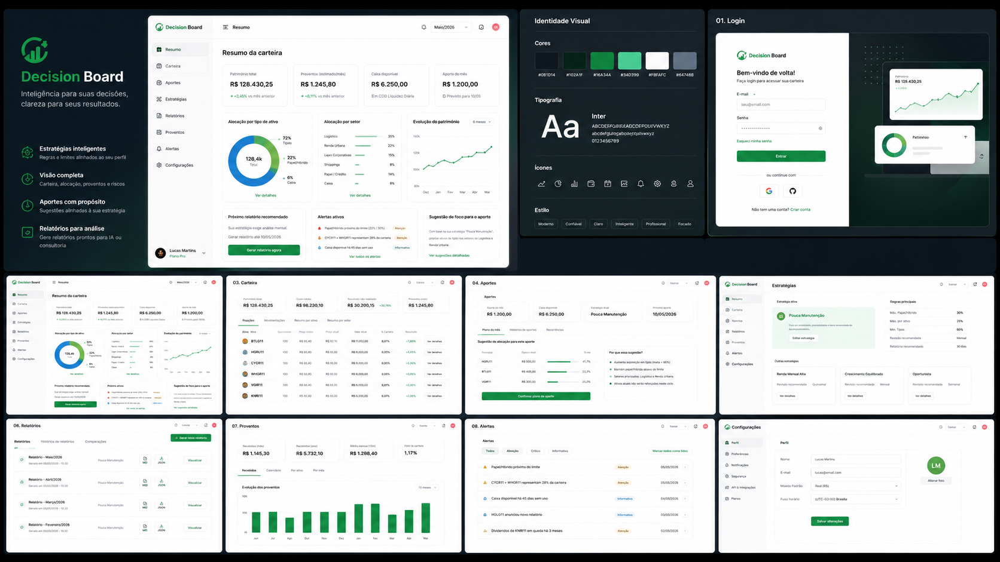

# Design References

O [briefing do novo produto](product-brief.md) orienta o próximo design, que será
produzido pelo usuário. As imagens abaixo são referências da visão anterior;
não representam aprovação visual para a nova implementação.

## Pacote para o novo design

- [Nome escolhido e arquitetura de marca](naming.md).
- [Briefing das telas e subfluxos](product-brief.md).
- [Sistema de design proposto](design-system.md).
- [Prompt autocontido para o Claude Design](claude-design-prompt.md).

O nome escolhido é **Ascend Compass**. O produto terá identidade própria, com
logo específico e poucos sinais de parentesco com
[Ascend](https://ascendteam.cloud/). Cores e fontes não são uma herança obrigatória.
Este pacote não renomeia o repositório.

## Referências anteriores

Source board:

Individual references:

| Reference | File |
|---|---|
| Brand cover | [00-brand-cover.png](references/00-brand-cover.png) |
| Dashboard hero | [00-dashboard-hero.png](references/00-dashboard-hero.png) |
| Visual identity | [00-identidade-visual.png](references/00-identidade-visual.png) |
| Login | [01-login.png](references/01-login.png) |
| Resumo | [02-resumo.png](references/02-resumo.png) |
| Carteira | [03-carteira.png](references/03-carteira.png) |
| Aportes | [04-aportes.png](references/04-aportes.png) |
| Estrategias | [05-estrategias.png](references/05-estrategias.png) |
| Relatorios | [06-relatorios.png](references/06-relatorios.png) |
| Proventos | [07-proventos.png](references/07-proventos.png) |
| Alertas | [08-alertas.png](references/08-alertas.png) |
| Configuracoes | [09-configuracoes.png](references/09-configuracoes.png) |
